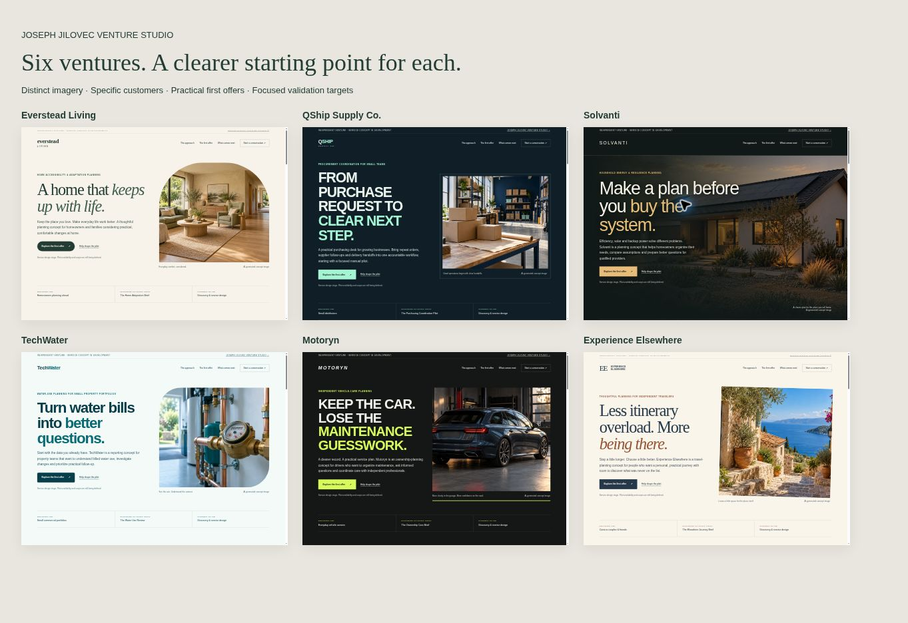

# Six venture website redesigns

Expanded the six incubation concepts while preserving DESIGN lifecycle status and existing hosting destinations.

| Venture | First audience | Proposed offer |
| --- | --- | --- |
| Everstead Living | Homeowners planning ahead and their families | Home Adaptation Brief |
| QShip Supply Co. | Small distributors and growing online retailers | Purchasing Coordination Pilot |
| Solvanti | Homeowners comparing energy and backup options | Household Energy Brief |
| TechWater | Managers of small commercial property portfolios | Water Use Review |
| Motoryn | Everyday vehicle owners and busy households | Ownership Care Brief |
| Experience Elsewhere | Independent travelers planning a short one-region trip | Elsewhere Journey Brief |

Each standalone site now includes detailed positioning, customer groups, a bounded offer, deliverables, a three-step process, a labeled example, proposed validation targets, FAQs and a browser-local inquiry builder. The inquiry builder creates an editable email brief and does not send, persist or submit visitor data.

## Imagery

Six distinct hero images were produced with the built-in image generation tool. The optimized WebP files are committed locally in each venture repository and here in `public/project-hero/`. The images are labeled as AI-generated concepts and not documentary evidence. Full generation briefs are committed as `assets/IMAGE_NOTES.md` in the corresponding venture repository.

## Portfolio integration

The six entries in `lib/portfolio.ts` use the same positioning as the individual sites. `lib/ventureImagery.ts` points to the generated imagery. A launch-plan section on the six project files adds audiences, offer deliverables and proposed validation milestones. Other ventures retain their existing project-file structure.

## Verification

- Main portfolio TypeScript check and production build passed; 71 routes generated.
- All six standalone JavaScript files passed Node syntax checks.
- All six standalone pages passed internal-anchor, local-asset, unique-ID and single-H1 checks.
- Browser checks on all six pages confirmed image loading, no desktop horizontal overflow, inquiry generation and edited-brief email synchronization.
- All six mobile menus opened and closed correctly in 390px preview frames. Fixed Solvanti full-bleed-image horizontal overflow.
- Desktop and mobile layouts visually reviewed, including the six-site overview below.
- No messages, bookings or payments were sent during QA.
- The portfolio passed its production build; browser preview for that Next.js app was unavailable because the managed preview launcher passed an unsupported `--host` flag. Its pages were not browser-tested in this session.

Hosting deployment status must be checked against the repository commits; local checks do not by themselves verify production rollout.

